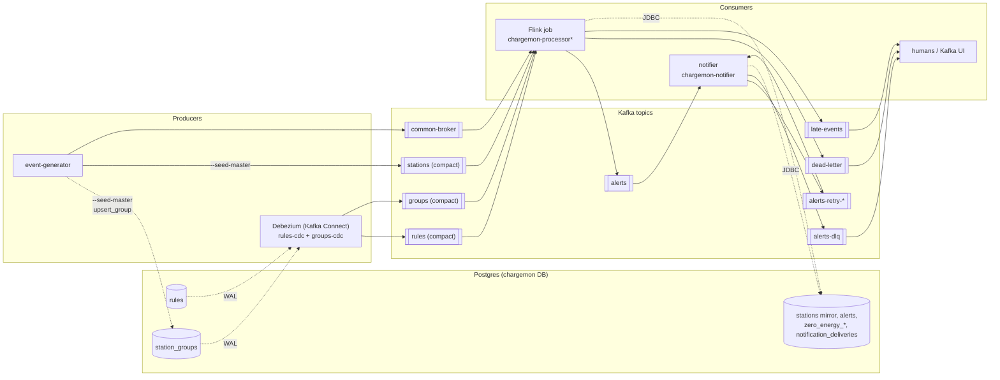
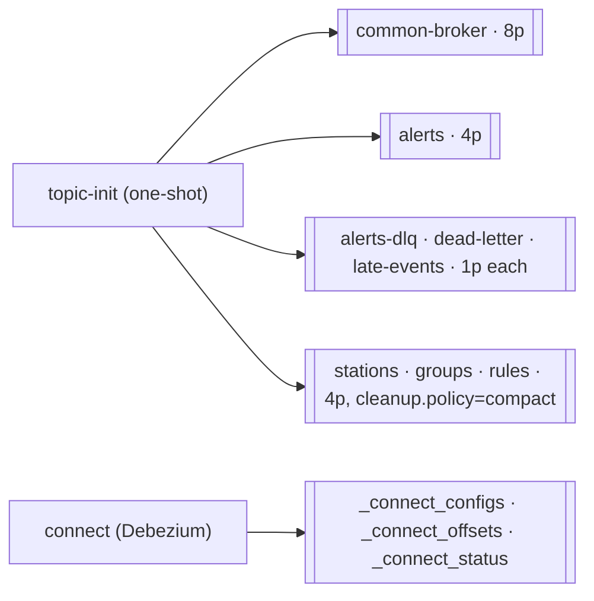
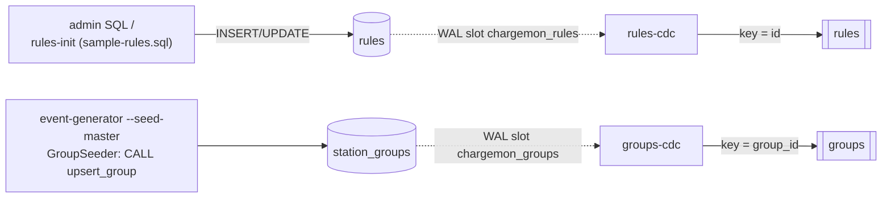
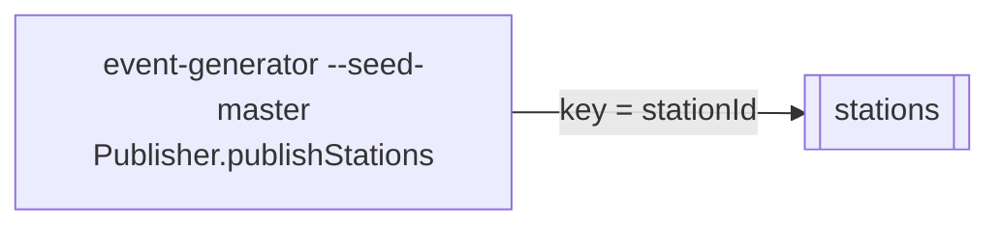
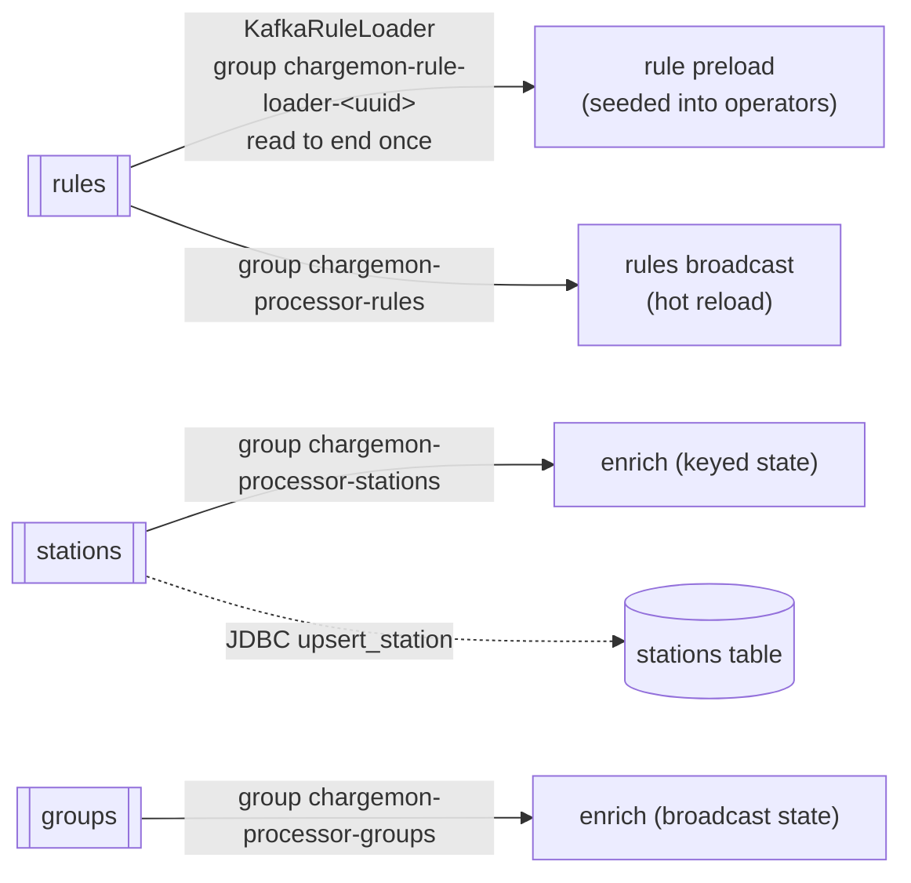
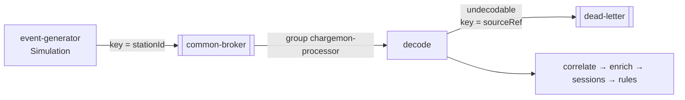
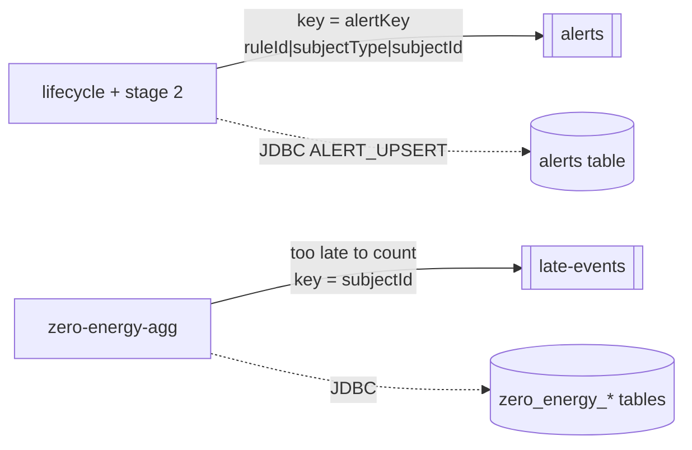
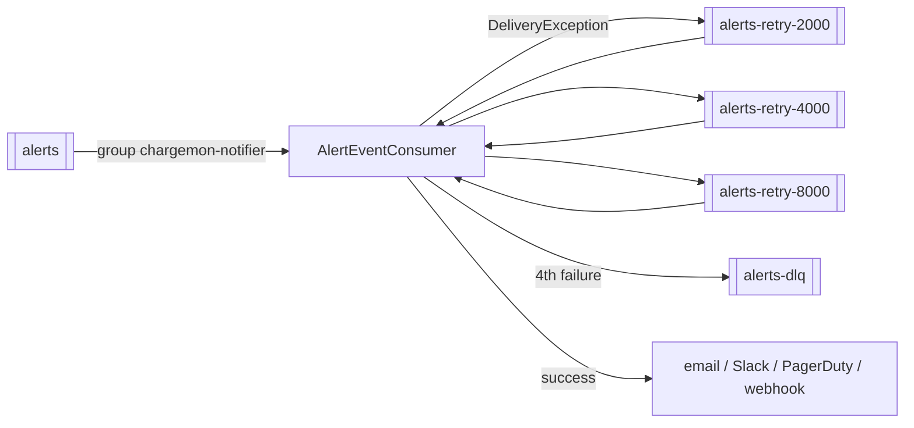
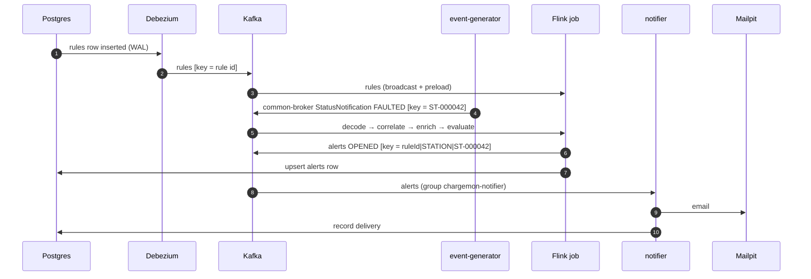

# 21. Kafka topic map

**Goal.** After this chapter you can name every Kafka topic in the stack, say who writes it, who
reads it (and with which consumer group), and walk a single alert from a Postgres row or an OCPP
frame all the way to an email, one hop at a time.

**Prerequisites.**
[04 Kafka and CDC basics](04-kafka-and-cdc-basics.md),
[13 Architecture overview](13-architecture-overview.md).

## The big picture

Producers on the left, topics in the middle, consumers on the right. Solid arrows are Kafka
writes and reads; dashed arrows are Postgres reads and writes.

The rest of the chapter builds this picture one step at a time, in the order things happen when
you run `docker compose -f deploy/docker-compose.yml --profile load up`.

## Step by step

### Step 0: the stack creates the topics

Nothing is auto-created by producers. The one-shot `topic-init` service in
[`deploy/docker-compose.yml`](../deploy/docker-compose.yml) runs `kafka-topics.sh --create` for
every topic before Flink, the notifier or the generator start. Kafka Connect creates its own three
bookkeeping topics when the `connect` service boots.

Only the notifier's `alerts-retry-*` topics are created at runtime, by Spring Kafka (step 6).

### Step 1: rules and groups leave Postgres through Debezium

Rules and the group hierarchy are both rows in the same Postgres database. The `connector-init`
service registers two Debezium connectors, one per table, because each needs a different Kafka
key column.

- Connectors: [`rules-connector.json`](../deploy/debezium/rules-connector.json),
  [`groups-connector.json`](../deploy/debezium/groups-connector.json). Both use the same three SMTs:
  `unwrap` (keep only the new row, add `__deleted`), `key` (bare id string as the Kafka key),
  `route` (rename `cdc.public.<table>` to the short topic name).
- Both tables are `REPLICA IDENTITY FULL` (`V003__rules.sql`, `V008__groups_cdc.sql`) so a delete
  still carries the key; a tombstone follows so compaction can drop it.
- Group seeding: [`GroupSeeder.java`](../event-generator/src/main/java/com/chargemon/generator/GroupSeeder.java).

### Step 2: station master data goes straight to Kafka

Stations do not go through Postgres first. The generator (or, in production, a station registry)
publishes them to the compacted `stations` topic, keyed by station id.

### Step 3: the Flink job starts and replays the control topics

Before the first OCPP event is evaluated, the job loads everything it needs to know about rules,
stations and groups. All three compacted topics are read from the earliest offset every time, so
the job always sees the latest value per key.

- Sources: [`KafkaSources.java`](../flink-processor/src/main/java/com/chargemon/flink/source/KafkaSources.java)
  (`compacted(...)` builds the group id as `chargemon-processor-<name>`).
- Preload: [`KafkaRuleLoader.java`](../flink-processor/src/main/java/com/chargemon/flink/control/KafkaRuleLoader.java).
- Groups are **not** written back to Postgres: `station_groups` is their source, and a mirror
  would loop through CDC forever.

### Step 4: OCPP traffic flows in, bad frames go out to `dead-letter`

The key is the station id, so all frames from one station land on one partition and stay in order.
See [chapter 17](17-flink-job-ingest-pipeline.md) for what happens inside the job.

### Step 5: the job emits alerts and late sessions

Sinks: [`ProductionSinks.java`](../flink-processor/src/main/java/com/chargemon/flink/sink/ProductionSinks.java).
Delivery to Kafka is at-least-once; the alert key plus a sequence number lets consumers drop
duplicates.

### Step 6: the notifier delivers, retries, and gives up into `alerts-dlq`

Retry policy lives on the `@RetryableTopic` annotation in
[`AlertEventConsumer.java`](../notifier/src/main/java/com/chargemon/notifier/consumer/AlertEventConsumer.java):
4 attempts, backoff 2 s × 2. Retry topics are named `<topic>-retry-<delay ms>`. Malformed
payloads are acknowledged and skipped, not retried. See [chapter 19](19-notifier-spring-boot.md).

### One alert, end to end

## Cheat sheet

| Topic | Partitions / policy | Key | Producer | Consumer (group) | Env var |
|---|---|---|---|---|---|
| `rules` | 4, compact | rule id | Debezium `rules-cdc` ← `public.rules` | Flink `chargemon-processor-rules`; `KafkaRuleLoader` (random group) | `TOPIC_RULES` |
| `groups` | 4, compact | group id | Debezium `groups-cdc` ← `public.station_groups` | Flink `chargemon-processor-groups` | `TOPIC_GROUPS` |
| `stations` | 4, compact | station id | generator `--seed-master` | Flink `chargemon-processor-stations` | `TOPIC_STATIONS` |
| `common-broker` | 8, delete | station id | generator `Simulation` (real CSMS gateway in prod) | Flink `chargemon-processor` | `TOPIC_EVENTS` |
| `alerts` | 4, delete | alert key | Flink alerts sink | notifier `chargemon-notifier` | `TOPIC_ALERTS` |
| `alerts-retry-*` | auto-created | alert key | notifier | notifier | (suffix `-retry`) |
| `alerts-dlq` | 1, delete | alert key | notifier, after 4 failed attempts | humans | (suffix `-dlq`) |
| `dead-letter` | 1, delete | source ref | Flink `decode` side output | humans | `TOPIC_DEAD_LETTER` |
| `late-events` | 1, delete | subject id | Flink `zero-energy-agg` side output | humans | `TOPIC_LATE_EVENTS` |
| `_connect_*` | internal | | Kafka Connect | Kafka Connect | |

Topic names come from [`JobConfig.java`](../flink-processor/src/main/java/com/chargemon/flink/config/JobConfig.java)
and [`notifier/application.yml`](../notifier/src/main/resources/application.yml).

## Self-check

1. You run `UPDATE station_groups SET parent_id = 'region:fr1' WHERE group_id = 'site:de1-1'`.
   Which topic gets a record, with which key, and which Flink operator reacts?
2. Why are `rules` and `groups` captured by two connectors instead of one?
3. Which topics have no consumer in the code, and who is expected to read them?

Answers

1. `groups-cdc` writes the new row to `groups` with key `site:de1-1`; the `enrich` operator
   updates its broadcast group tree, so later events from stations at that site carry the new
   ancestor chain.
2. The `key` SMT (`ExtractField$Key`) takes one field name per connector: `id` for `rules`,
   `group_id` for `station_groups`.
3. `alerts-dlq`, `dead-letter` and `late-events`. They are for humans and tooling (Kafka UI at
   <http://localhost:8090>), to inspect and replay.

